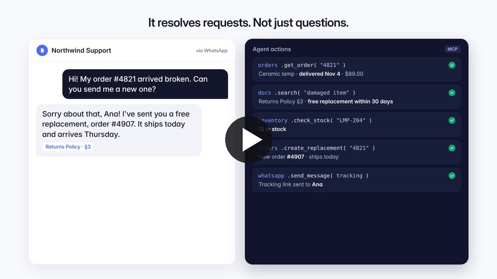

# Enterprise Data AI

### AI customer support agents that resolve requests, not just answer them.

Connect your company data and your business systems. The agent fixes orders, issues refunds with human approval and hands off to your team with full context, on WhatsApp, email and web chat. Every action is logged.

[](https://www.enterprisedataai.com/)
[](https://www.enterprisedataai.com/#demo)

[](https://www.enterprisedataai.com/#demo)

*The demo shows three support cases: a replacement the agent handles on its own, a refund that waits for a person, and a request it hands off instead of guessing. Sample company and data.*

---

## Contents

- [Why it matters](#why-it-matters)
- [What the agent does](#what-the-agent-does)
- [How it works](#how-it-works)
- [Safety by design](#safety-by-design)
- [Use cases](#use-cases)
- [Integrations](#integrations)
- [Architecture](#architecture)
- [What we measure](#what-we-measure)
- [Run it](#run-it)
- [Work with us](#work-with-us)

---

## Why it matters

Most support bots stop at a reply and leave the work to your team. Customers judge a company on whether the problem got fixed.

| Typical chatbot | Enterprise Data AI agent |
| :--- | :--- |
| Answers from a FAQ and can't touch your systems | Looks up orders and payments and makes the change |
| Guesses when the answer isn't in its data | Cites the policy it used, and hands off when there isn't one |
| Escalates without context, so customers repeat themselves | Passes your team a summary and the customer's history |
| No record of what it did or why | Logs every action, approval and handoff |

---

## What the agent does

- **Resolves end to end.** Checks the order, the policy and the stock, then makes the change and confirms it with the customer.
- **Answers with the source.** Uses hybrid RAG over your company data and shows the policy behind every answer.
- **Asks before risky actions.** Refunds above the limit you set wait for a person to approve them. Nothing moves until they do.
- **Hands off with context.** When there's no policy, it doesn't guess. It opens a ticket with a summary and the customer's history.
- **Logs every action.** A full audit trail shows each action, whether it ran automatically, who approved it and what was handed off.
- **One agent, every channel.** The same agent works on WhatsApp, email and web chat, with the same knowledge and the same rules.

---

## How it works

### 1. Connect your company data

Policies, tickets, emails, call transcripts and scanned documents become searchable with hybrid RAG (BM25 keyword search plus vector search). Every answer points to its source.

`PDF` · `Support tickets` · `Emails` · `Call transcripts` · `Slack threads` · `Scans (OCR)`

### 2. Connect your systems through MCP

The agent reads and acts in your business systems through MCP servers: it can look up an order, create a replacement or open a ticket. You choose which tools it can use.

`orders` · `inventory` · `payments` · `helpdesk` · `crm`

### 3. Go live where customers write

One agent serves every channel with the same knowledge, the same rules and one audit trail.

`WhatsApp` · `Email` · `Web chat`

### Example: a damaged order

```text
Customer (WhatsApp): "Hi! My order #4821 arrived broken. Can you send me a new one?"

orders.get_order("4821")              → Ceramic lamp · delivered Nov 4 · $89.00
docs.search("damaged item")           → Returns Policy §3 · free replacement within 30 days
inventory.check_stock("LMP-204")      → 12 in stock
orders.create_replacement("4821")     → New order #4907 · ships today
whatsapp.send_message(tracking)       → Tracking link sent

Agent: "Sorry about that, Ana! I've sent you a free replacement, order #4907.
        It ships today and arrives Thursday."   [Returns Policy · §3]
```

---

## Safety by design

The agent is autonomous where it's safe and supervised where it matters.

- **Approval limits you set.** For example, refunds above $200 always go to a person first.
- **No source, no guess.** If your data has no answer, the agent hands the case to your team.
- **Full audit trail.** Every tool call is recorded with its time, its result and who approved it.

```text
10:02:12  orders.get_order 4821               auto
10:02:14  orders.create_replacement #4907     auto
10:02:15  whatsapp.send_message tracking      auto
10:05:38  docs.search · Billing Policy §2     auto
10:05:41  payments.refund $480.00             approved · Maria
10:12:25  crm.lookup_customer                 auto
10:12:27  helpdesk.create_ticket #1132        handoff · Sales
```

*Sample data from the demo.*

---

## Use cases

| Request | What the agent does |
| :--- | :--- |
| **Order problems**: *"My order arrived broken."* | Checks the order and the policy, then creates the replacement. |
| **Billing and refunds**: *"I was charged twice."* | Finds the duplicate charge and prepares the refund, with approval above your limit. |
| **Policy and product questions**: *"Is this still under warranty?"* | Answers from your own documents, with the source attached. |
| **Escalations**: *"Can I get a volume discount?"* | Routes the request to the right team with full context. |

---

## Integrations

The agent connects to business systems through MCP servers. Each one exposes a small set of tools, and you decide which ones the agent may call and which need approval.

| System | Example tools | Typical rule |
| :--- | :--- | :--- |
| **Orders** | `get_order`, `create_replacement` | Automatic within policy |
| **Inventory** | `check_stock` | Automatic |
| **Payments** | `list_charges`, `refund` | Approval above your limit |
| **Helpdesk** | `create_ticket` | Automatic handoff |
| **CRM** | `lookup_customer` | Automatic |
| **Channels** | `send_message` on WhatsApp, email and web chat | Automatic |

---

## Architecture

```text
Customer message (WhatsApp · Email · Web chat)
        │
        ▼
Understand the request  →  identify the customer and the intent
        │
        ▼
Hybrid RAG over company data  →  find the policy that applies (with citation)
        │
        ▼
Tool use via MCP  →  orders · inventory · payments · helpdesk · crm
        │
        ├── Within policy, low risk    →  executed automatically
        ├── Above approval limit       →  waits for a person
        └── No supporting policy       →  handoff ticket with full context
        │
        ▼
Grounded reply to the customer  +  audit log entry
```

Main modules:

| Path | Purpose |
| :--- | :--- |
| `docchat/assistance_ai/graph/` | Agent graph: intent, decision policy, tool registry and response validation |
| `docchat/agentic_mcp_a2a_bridge.py` | MCP tool bridge |
| `docchat/audit/` | Audit trail |
| `api_server.py` | REST API |

---

## What we measure

The goal is resolved requests, not deflected ones. Each conversation is tracked by outcome:

- **Resolved end to end** by the agent
- **Approved by a person** before an action ran
- **Handed off** to a team, with context
- **Every tool call** with its time, result and approver

---

## Run it

```bash
git clone https://github.com/santinogenta27/AI-Agents-for-Enterprise-Private-Data.git
cd AI-Agents-for-Enterprise-Private-Data
```

Create a `.env` file in the project root with your model key and the keys of the systems and channels you connect:

```env
OPENAI_API_KEY=your_openai_api_key
```

Start it with Docker:

```bash
docker compose up --build
```

---

## Work with us

Tell us which requests take most of your team's time. We'll show you how the agent would resolve them with your data and your systems.

Built by **Santino Genta**, Founder & AI Engineer at Enterprise Data AI · Buenos Aires · works remotely. Multi-agent systems, enterprise RAG and MCP integrations, with human approval and an audit trail built in from day one.

- Website: [enterprisedataai.com](https://www.enterprisedataai.com/)
- WhatsApp: [+54 9 11 2849 2480](https://wa.me/5491128492480)
- Email: [enterprisedataai@gmail.com](mailto:enterprisedataai@gmail.com)
